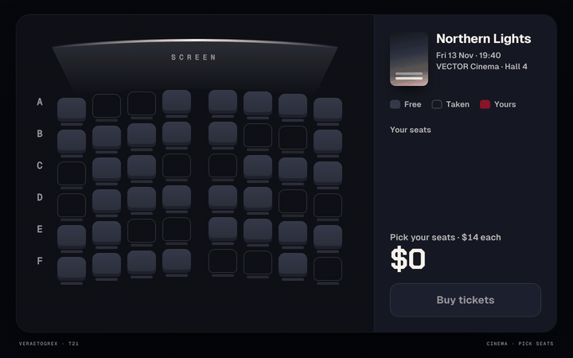

# Cinema Seats

**Drag across a row. The seats become your ticket.**



**Live demo:** [veraetogrex-portfolio.github.io/cinema-seats](https://veraetogrex-portfolio.github.io/cinema-seats/) · **Mockup:** [full-screen version](https://veraetogrex-portfolio.github.io/cinema-seats/mockup/cinema-seats.html)

Drag across a row to pick seats, the price counts up as you go. Hit Buy and the seats lift out of the hall and fold into one ticket, it flips to its QR code and drops into your wallet.

## Use it

Three files, no build step, no dependencies, no web fonts:

```
index.html   markup
style.css    styles and keyframes
script.js    behaviour
```

Download the repo and open `index.html`, or copy the three files into your project.

## Try it

- Press and drag along a row: every free seat you pass is added. Start the drag on a picked seat to drop seats instead.
- Seats are buttons too: Tab to one and press Enter or Space.
- Taken seats are outlined and skipped.

## Make it yours

`PRICE`, `ROWS`, `COLS` and the `TAKEN` list at the top of `script.js` set up the hall; the film, date and hall are plain HTML in `index.html`. Three colour themes ship in `style.css`: velvet (default), ember and mono — add `th-ember` or `th-mono` to `<body>`.

## What's in `mockup/`

The full 1440×900 screen this component was shot in for the reel:

- `mockup/cinema-seats.html` — interactive. `D` plays the demo, `R` resets.
- `mockup/cinema-seats.autoplay.html` — the scripted loop the reel was recorded from.
- URL flags: `?frame` puts the screen in a browser window, `?clean` hides the control panel, `?once` plays the demo once.
- `?theme=velvet|ember|mono` switches the palette in the mockup.

The mockup loads the same `style.css` and `script.js` from the root, plus a shared stage runtime and bundled fonts from `mockup/_shared/`. The component in the root doesn't need any of it.

---

Component 21 of a series. New one every day on Instagram [@veraetogrex_portfolio](https://www.instagram.com/veraetogrex_portfolio/) · all components: [github.com/veraetogrex-portfolio](https://github.com/veraetogrex-portfolio)

MIT licensed.
